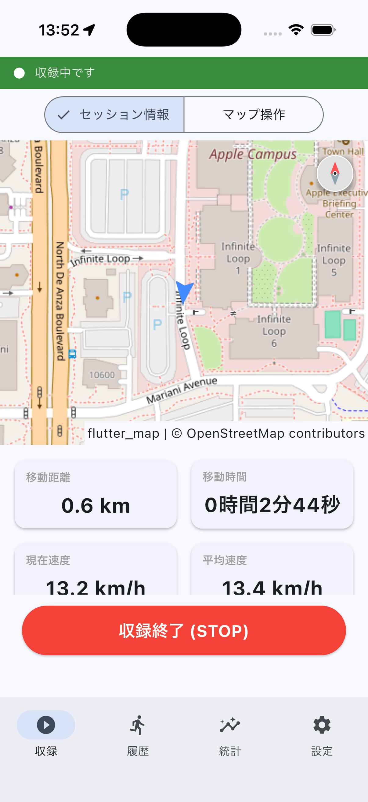
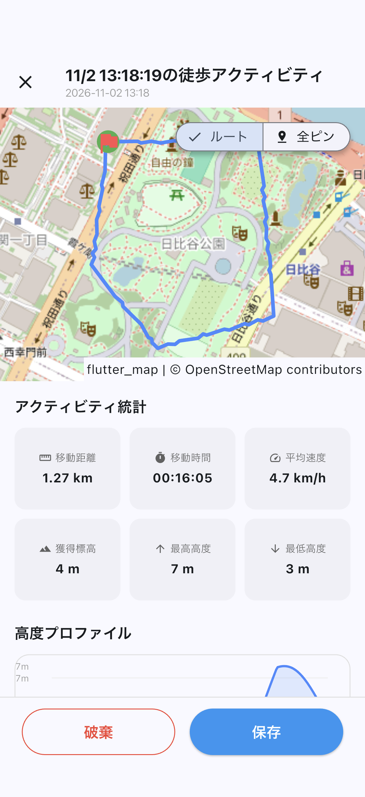
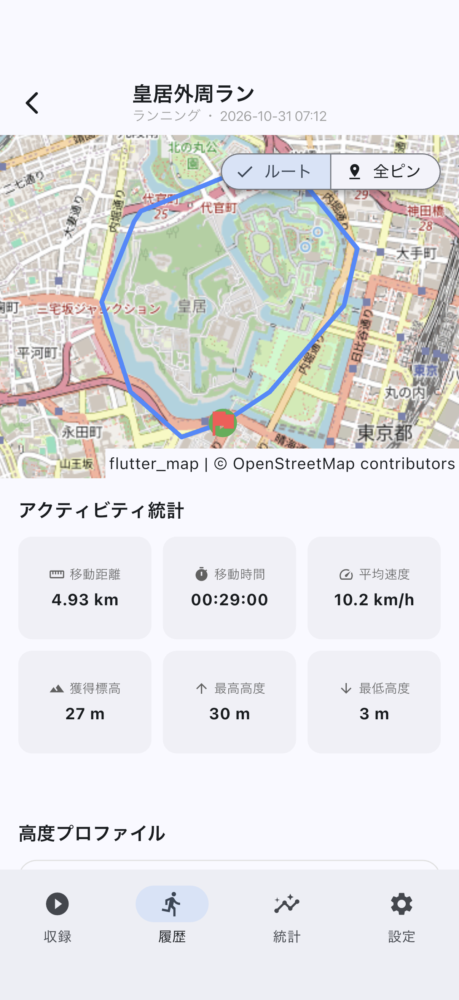
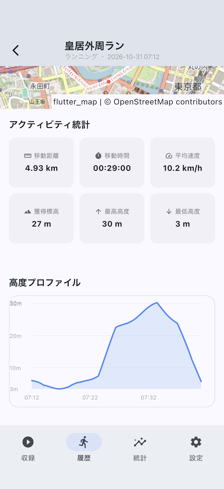
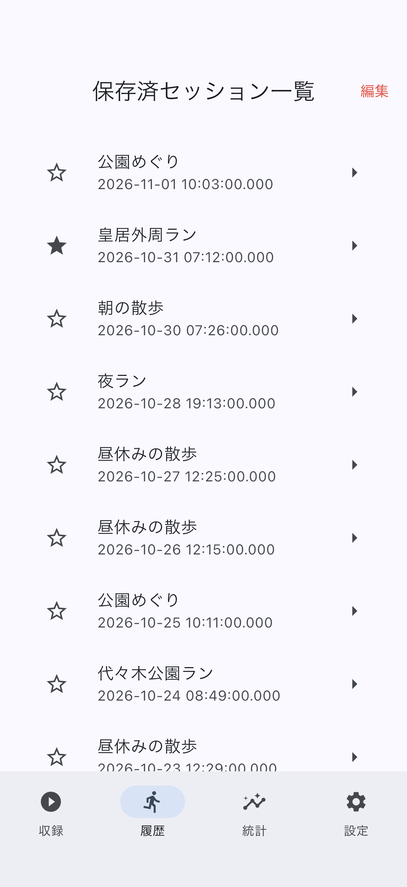
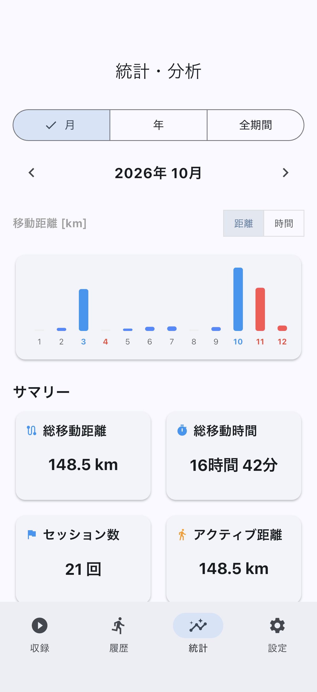
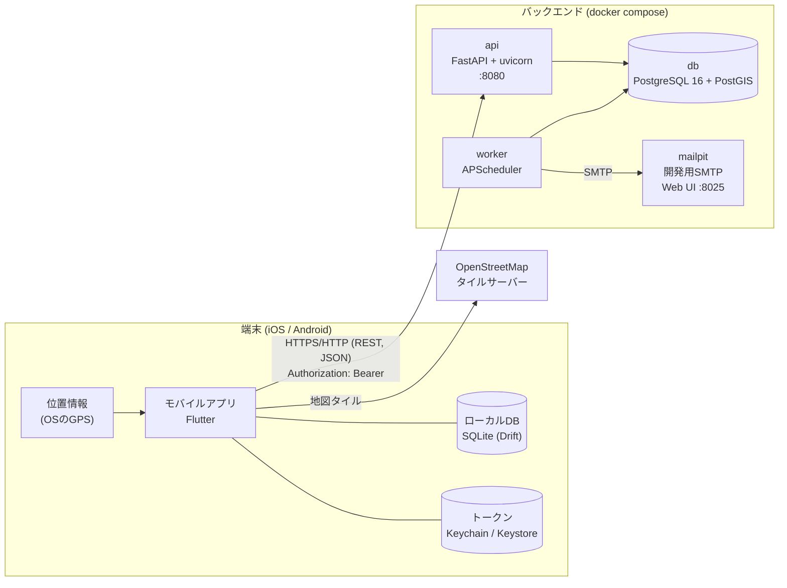

# osampo-tracker

散歩・ランニングなどの移動を記録するモバイルアプリと、そのバックエンドです。
収録中は数秒おきに現在位置を端末に記録し、地図上の軌跡・距離・時間・高度として振り返れます。
記録はサーバーと同期し、同じアカウントの別の端末からも見られます。

- 個人開発。モバイルアプリ(Flutter)・APIサーバー(FastAPI)・DB(PostgreSQL/PostGIS)を一通り設計・実装しています
- ストアでの公開はしておらず、開発環境(シミュレータ/実機 + ローカルの`docker compose`)で動かしています

## スクリーンショット

| 収録中 | 保存/破棄 | 記録の詳細 |
|:---:|:---:|:---:|
|  |  |  |

| 高度プロファイル | 記録の一覧 | 統計 |
|:---:|:---:|:---:|
|  |  |  |

画面はダミーデータで撮影しています。地図: © [OpenStreetMap](https://www.openstreetmap.org/copyright) contributors

## 機能一覧

| 分類 | 主な機能 |
|---|---|
| 収録 | 現在地の表示、収録の開始/停止、5秒ごとの位置の記録、バックグラウンドでの収録、位置情報の状態(権限・精度低下・更新停止)のバナー表示、権限を失ったときの強制停止、強制終了で残った収録の回収 |
| 記録の閲覧・編集 | 一覧、詳細(ルート・全地点・距離・時間・平均速度・獲得標高・高度プロファイル)、名前・移動手段の編集、削除、お気に入り |
| 統計 | 月・年・全期間のグラフ(距離/時間)、サマリー、自己ベスト |
| 同期 | 複数端末間の差分同期、削除と編集の競合の解決 |
| アカウント | 新規登録、メールアドレスの確認(6桁のコード)、ログイン状態の維持(トークンの自動更新)、パスワード・表示名の変更、ログアウト、アカウントの削除、同期しないローカルアカウント(通常のアカウントとの相互の切り替え) |
| 運用 | メール送信(outbox)、期限切れデータの定期パージ、アカウントの停止、監査ログ、行レベルセキュリティ |

一覧の詳細は[機能一覧](docs/basic-design/features.md)を参照してください。

## 技術的なポイント

- **オフラインファーストの同期**: 記録はまず端末のDBに保存し、通信できるときにサーバーと同期します。サーバー時刻を基準にしたpull型の差分同期で、削除はtombstoneで他の端末に伝え、削除と編集が競合した場合の扱いも決めています([同期の設計](docs/design/sync.md))
- **認証を自前で実装**: 外部の認証サービスを使わず、ES256で署名したJWTのアクセストークンと、使うたびに取り替えるリフレッシュトークン(再使用の検知付き)を実装しています。ログイン試行回数の制限、監査ログも備えています([認証・セキュリティ](docs/basic-design/security.md))
- **DBでも権限を分離**: マイグレーション・API・定期実行ジョブでDBのロールを分け、記録のテーブルには行レベルセキュリティ(RLS)をかけて、アプリ層とDBの二重で他人のデータへのアクセスを防いでいます
- **位置情報の扱いの堅牢性**: GPSが未確定・低精度のときのフォールバック、権限を失ったときの強制停止、バックグラウンドでの収録の継続と、収録していないときの位置情報の購読停止([位置情報の設計](frontend/docs/location-tracking.md))
- **確実なメール送信**: メールは業務データと同じトランザクションでoutboxテーブルに積み、別プロセスのworkerが再試行付きで送ります

## 構成図

## 使用技術

| 領域 | 技術 |
|---|---|
| モバイルアプリ | Dart / Flutter、Riverpod、Drift(SQLite)、geolocator、flutter_map、fl_chart、flutter_secure_storage |
| APIサーバー | Python 3.12 / FastAPI、Pydantic、SQLAlchemy 2(非同期)+ psycopg 3、GeoAlchemy2、PyJWT、pwdlib(Argon2)、APScheduler |
| DB | PostgreSQL 16 + PostGIS、Alembic(マイグレーション) |
| テスト・品質 | flutter_test・integration_test(E2E)、pytest、ruff、GitHub Actions(CI)、Dependabot |
| 開発環境 | Docker Compose、uv、devcontainer、Claude Code |

## 開発の進め方

- **設計 → 実装 → テストを1機能ずつ**: 機能ごとに設計書を書いてから実装し、テストを揃えてmainに取り込みます。設計を変えたら同じ変更で設計書も更新しています
- **AIコーディングエージェントとの協働**: Claude Codeを、ホストのファイルや外部への通信を制限したdevcontainerの中で動かしています。設計の判断とレビューは自分で行い、実装とテストの作成をエージェントと分担しています
- **ホストでの検証をログで受け渡す仕組み**: コンテナの中にはFlutter SDKもDockerも入れていないため、E2Eやpush前の確認はホストで実行します。`run_checks.sh`が結果のサマリー・ログ・スクリーンショットをファイルに残し、それを読んで修正する流れにしています
- **CI**: GitHub Actionsで、PRごとにbackend(lint・マイグレーション・スキーマの差分確認・PostGISのサービスコンテナに対するpytest)と
  frontend(コード生成物の確認・静的解析・テスト)を並列に実行し、通ったものだけをmainにマージしています。E2Eはシミュレータが要るためホストで実行します
- **テスト**: frontendはユニット/ウィジェットテストと、`flutter drive`によるE2E(スクリーンショット付き)。backendは実DB(テスト用データベース)に対するpytestで、テストごとにトランザクションをロールバックします

## ドキュメント

| ドキュメント | 内容 |
|---|---|
| [開発ガイド](docs/development.md) | 開発環境、ディレクトリ構成、ローカルでの起動方法、テストの実行、git運用 |
| [基本設計書](docs/basic-design/system-overview.md) | システム概要、[機能一覧](docs/basic-design/features.md)、[画面](docs/basic-design/screens.md)、[データ](docs/basic-design/data.md)、[API一覧](docs/basic-design/api.md)、[認証・セキュリティ](docs/basic-design/security.md) |
| [同期の設計](docs/design/sync.md) | 端末とサーバーの差分同期、削除と編集の競合 |
| [詳細設計(アプリ)](frontend/docs/) | 位置情報の収録、バックグラウンドでの収録、未完了の収録の回収、画面ごとの仕様 |
| [API設計](backend/docs/API設計ドラフト.md) | エンドポイント、エラー形式、認証と権限 |
| [バックエンド構成](backend/docs/バックエンド構成.md) | 構成の選定理由、主な決定事項、実装方針、DBのロール、認証、メール |
| [E2Eテスト](frontend/docs/e2e.md) | integration_testの書き方、スクリーンショットの撮り方 |
