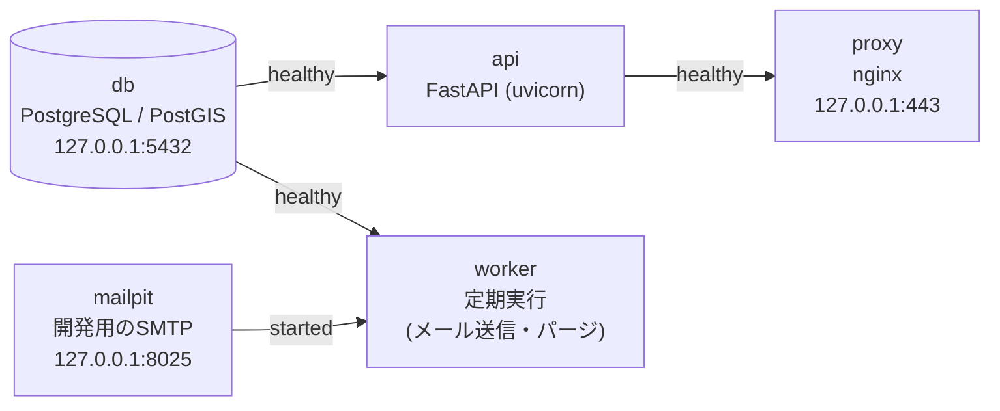
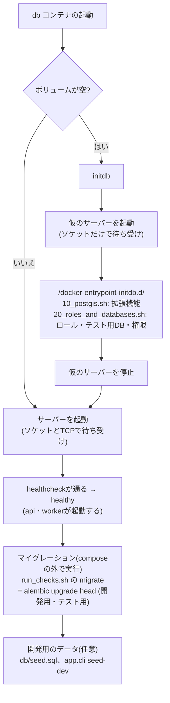

# バックエンド概要

backend(FastAPIのapi + 定期実行のworker + PostgreSQL)の構成・主な決定事項・実装方針・設定・起動・テスト。
機能ごとの設計は同じディレクトリの各文書(`database.md`・`sync-api.md`・`auth.md`・`mail.md`・`logging.md`・
`https-proxy.md`)にある。

## 構成の選定(2026-09-29決定)

当初はPostgRESTでDBを直接公開していたが、認証・メール送信を追加するにあたり、**PythonのAPIサーバー(FastAPI)**に
置き換えた。DBはPostgreSQL/PostGISを継続する。

置き換え前の問題:

- ユーザーIDはアプリに`11111111-...`として直書きで、`users`テーブルはパスワードを持たなかった
- PostgRESTはJWT未設定で、全リクエストが`web_anon`(全テーブルに`GRANT ALL`)として動いていた
- `register_session_with_points`(SECURITY DEFINER)と`fetch_remote_sessions`は、クライアントが送った`user_id`を
  そのまま信用していた。他人の`user_id`を送れば他人のデータを読み書きできた
- 削除tombstoneのパージは別イメージのcronコンテナで行い、複雑な処理はstored functionに押し込んでいた

FastAPIを選んだ理由:

- 開発者が慣れている言語(Python)で、理解のコストが低い
- リクエストの型検証とOpenAPIのAPI仕様書が自動で生成されるので、API設計として何を決める必要があるかが見えやすい
- 認証・メール送信・定期実行を1つのコードベースにまとめられる

見送った候補: Node.js(学習コストが重い)、Dart(サーバー側で使う必然性が薄い)、PostgREST継続+送信ワーカー
(認証がPL/pgSQLに埋まり見通しが悪い)、Supabase(認証を自前で実装する方針に反する)。

### サービス構成(docker compose)

| サービス | 役割 |
|---|---|
| `proxy` | nginx。TLSを終端してHTTPSで公開し、`/api/`だけを`api`へ転送する(2026-11-09に追加。`backend/docs/https-proxy.md`) |
| `db` | PostgreSQL/PostGIS |
| `api` | uvicornでFastAPIを常駐させ、エンドポイントを提供する(`restart: unless-stopped`) |
| `worker` | `api`と同じイメージ・同じコードで、起動コマンドだけ変える。メール送信(outbox)とパージを定期実行する |
| `mailpit` | 開発用のSMTP受信サーバーとWeb UI。外部にメールを出さない |

- 定期実行を`api`と同じプロセスで動かさないのは、ワーカー数を増やしたときにジョブが重複して走るため
- DBへはcomposeのネットワーク内でサービス名`db`で接続する
- ホストに公開するのはproxyの443番(HTTPS)と、開発で使うdb・mailpitのポートだけで、いずれも`127.0.0.1`に限る。`api`はホストに公開しない
- 依存パッケージはイメージのビルド時に入れる。サーバーの起動・テストはホスト側の`docker compose`で行う
- スキーマはAlembicのマイグレーションで管理する(置き換え前の`initdb.sql`はDROPしてから作り直す方式で、本番では使えないため)

### パッケージ

| 役割 | パッケージ |
|---|---|
| Webフレームワーク(ルーティング、依存注入) | FastAPI |
| サーバー本体(常駐プロセス) | uvicorn |
| リクエスト/レスポンスの型と検証 | Pydantic(FastAPIに同梱) |
| 設定・秘密情報の読み込み(`.env`) | pydantic-settings |
| DBドライバ | psycopg(v3) |
| ORMとクエリ | SQLAlchemy 2.x |
| PostGISの型 | GeoAlchemy2 |
| スキーマのマイグレーション | Alembic |
| パスワードハッシュ | pwdlib[argon2](passlibは保守が止まっているので使わない) |
| JWTの発行・検証 | PyJWT |
| メール送信 | 標準ライブラリのsmtplib |
| 定期実行 | APScheduler(`worker`内) |
| テスト | pytest + pytest-asyncio、httpxの`AsyncClient`(`ASGITransport`) |
| パッケージ管理・lock | uv(`pyproject.toml` + `uv.lock`) |
| lint | ruff |

## 主な決定事項

- 認証基盤は外部サービス(Firebase Auth等)を使わず**自前で実装**する
- パスワードの検証はサーバー側だけで行う。端末にはパスワードを保存せず、トークンだけを
  `flutter_secure_storage`(Keychain/Keystore)に保存する
- 同期は**ログイン中のユーザーのレコードだけ**を切り出す。user_idはクライアントの申告ではなくトークンから決める
- ローカルデータはユーザーごとに分けて保持する(1台の端末で複数アカウントを使い分けることは想定しないが、
  セッションにユーザーが紐づいているため)
- トークンが切れていても記録・閲覧はでき、止まるのは同期だけにする(オフラインファーストを維持)
- メール確認を入れる。確認方法はリンクではなく6桁コードの入力にする(Universal Links/App Linksの設定を避けるため)
- ログイン中のパスワード変更は現在のパスワードで確認する(メール不要)。メールが必要なのは忘れたときのリセットだけ
- SNS的な拡張(bio・フォロー/フォロワー)はやらない。表示名だけ持つ
- リフレッシュトークンを入れる(2026-10-06決定。現代的な認証のスタンダードに倣う)。期限切れのアクセストークンには
  401(`token_expired`)を返し、端末は再ログインではなくトークンの更新を行う
- サインアップは**メール確認付きの自由登録**にする(2026-10-07決定。個人向けアプリには管理者招待型より自由登録が合う)
- 認証の詳細(2026-10-07〜08に設計): パスワードは8〜128文字・MFAなし、アクセストークンはES256のJWT(15分)、
  リフレッシュトークンは256ビットの乱数(30日・使うたびに取り替え・使用済みが使われたらその端末のログイン状態を無効にする)、
  端末ごとのログイン状態とトークンの系列をセットで持ちアクセストークンも毎回DBで突き合わせる、アカウントの削除は関連データごと物理削除、
  メールアドレスの確認前もログインできるが同期はできない。詳細は`backend/docs/auth.md`の「認証」
- ゲストの代わりに**ローカルアカウント**(同期しないアカウント。複数作れる・通常のアカウントと相互に変更できる)を用意する
  (2026-10-08決定、2026-10-27設計)。ローカル→通常は新規登録に加えて既存の通常のアカウントへのログインでの合流もでき、
  `users.id`の書き換えではなくsessionsの付け替えで行う。詳細は`frontend/docs/overview.md`の「ローカルアカウント」

## 移植の方針

- 同期の仕組み(差分pull、tombstoneによる削除、削除と編集の競合の検出)は現行のまま残し、エンドポイントと処理内容を書き換える
- PostgRESTの形(`/rpc/...`・`?id=eq.`)には合わせず、`/users/{user_id}/sessions/...`のREST形式にする。
  user_idはクライアントが本文で送らず、パスパラメーターで指定してトークンと照合する
- URLにバージョン(`/v1`)は入れない。開発中の端末しか使わず、リリース版では同期を無効化するため。
  本番運用では、アプリのバージョンを見て更新を促す仕組みが別途必要になる
- 同期の管理に使う時刻(`updated_at`・`deleted_at`・差分取得の基準時刻)はサーバー時刻を正とする。
  `started_at`・`ended_at`・`recorded_at`は端末で記録した時刻(データそのもの)なので端末の時刻のまま
- `deleted_at`は「パージ予定日時」から「削除した日時」に意味を変える

## 実装方針

- 非同期(`async def`)で書く。DBアクセスはSQLAlchemy 2.xの非同期API + psycopg(v3)
  - 関連の遅延ロードは使えないので、`selectinload`等で明示的に読み込む
  - テストは`httpx.AsyncClient` + `pytest-asyncio`、Alembicは非同期用の`env.py`、workerはAPSchedulerの`AsyncIOScheduler`
- DBアクセスはORM中心で、PostGISの部分はGeoAlchemy2で書く。ストアドファンクション(`register_session_with_points`・
  `fetch_remote_sessions`)は廃止する
- レイヤ構成:

  | レイヤ | 役割 | Springで言うと |
  |---|---|---|
  | `routers` | URLとメソッドの対応、リクエストの受け取り、ステータスコード。認証は依存注入で付ける | `@RestController` |
  | `schemas` | リクエスト/レスポンスの型と入力チェック(Pydantic) | DTO + Bean Validation |
  | `services` | 業務ルール(競合の判定、所有者の確認など)とトランザクションの範囲 | `@Service` |
  | `models` | テーブルの定義(ORM) | `@Entity` |

  DB操作が増えてきたら`services`と`models`の間に`repositories`を挟む
- エラーレスポンスは`{"code": ..., "message": ..., "details": [...]}`に揃える(FastAPI既定のエラーも例外ハンドラーで変換する。
  詳細は上記「API(共通)」の「エラーレスポンス」)
  - services層などで処理を続けられない場合は`AppError(ステータス, ErrorCode.xxx, メッセージ)`を投げる(`app/errors.py`)。
    例外ハンドラー(`app/error_handlers.py`のinstall_error_handling)がJSONレスポンスに変換する
  - bodyを受け取るエンドポイント(POST・PATCH)には`dependencies=[Depends(require_json_content_type)]`を付けて、
    Content-Typeが`application/json`でなければ415にする(`app/dependencies.py`)
  - bodyのサイズの上限(既定10MB、`MAX_REQUEST_BODY_BYTES`で変更可)はミドルウェアで全てのリクエストに適用する

## API(共通)

APIの入出力の型・各項目の説明・例・ステータスごとの`code`は、実装から自動で生成するOpenAPIにある。この節と各機能の文書の
「エンドポイント」には、OpenAPIに載らない判定の順番・処理の手順・判断の理由を書く。

- URL: `https://localhost/api`(開発環境。リバースプロキシ経由。`backend/docs/https-proxy.md`)。
  実装は、同期が`app/routers/sessions.py`、認証・ユーザーが`app/routers/auth.py`・`app/routers/users.py`
- OpenAPIはリバースプロキシでは公開しない。apiのコンテナの中から取り出す:
  `docker compose exec api python -c "import urllib.request; print(urllib.request.urlopen('http://localhost:8080/openapi.json').read().decode())"`。
  内容(operationId・エラーのcodeの記載・例)は`tests/test_openapi.py`で確かめている

### 判定の順番

各エンドポイントの処理は、次の順に判定する(DBに問い合わせない確認を先に行う):

1. リクエストの形式: bodyのサイズ(413)、Content-Type(415)、Accept(406)
2. 認証と権限: 401(`unauthenticated`・`token_expired`)、403(`forbidden`)、同期APIでは403(`email_not_verified`)
3. ユーザーの存在: 404(`user_not_found`)
4. 入力チェック: 422
5. 業務ルール(sessionの存在・削除済みかどうか等): 404(`session_not_found`)・409

ただし、パスパラメーターの書式の不正(UUIDでない等)は、ユーザーの存在の確認より先に422になる。

### 認証と権限

トークンの仕組みは`backend/docs/auth.md`。

- ログイン・サインアップ・トークンの更新以外のエンドポイントは、`Authorization: Bearer <アクセストークン>`ヘッダーが必須
- リクエストのたびに、トークンの署名・有効期限に加えて、DBで「ユーザーが存在し停止(`disabled_at`)されていない」
  「`sid`の端末のログイン状態が無効になっていない」ことを確かめる(ログアウト・削除・停止がすぐ反映されるように)。
  ロールはトークンに入れず、リクエストのたびにDBから読む
- 401: 認証できない場合は`unauthenticated`(クライアントは再ログインを促す)、有効期限切れは`token_expired`
  (クライアントはリフレッシュトークンでトークンを更新し、元のリクエストをやり直す)
- 403(`forbidden`): 認証はできたが、管理者でなく、パスパラメーターのuser_idが自分自身でない。再ログインしても結果は変わらない
- 403(`email_not_verified`): 同期API(`/users/{user_id}/sessions/...`)は、メールアドレスの確認が済んでいなければ使えない
  (ログインはできる)
- この順に判定するので、一般ユーザーに404(`user_not_found`)が返ることはない(他ユーザーのuser_idは403で、自分自身が存在しなければ
  401で止まる)。404(`user_not_found`)は管理者が存在しないuser_idを指定した場合だけで、一般ユーザーには他ユーザーの有無が分からない
- パスパラメーターのuser_idは操作対象のユーザーを指定するためのもので、秘密の情報ではない(URLやログに残り、JWTの中身も
  暗号化されていない)。本人であることの確認はトークンの署名の検証だけで行う

### リクエストID

- 全てのレスポンスに`X-Request-ID`ヘッダーを付ける(アクセスログ・アプリのログ・監査ログの突き合わせに使う)。
  IDはリバースプロキシが作り、クライアントが送ったものは使わない(`backend/docs/https-proxy.md`の「リクエストID」)
- ログでの振り返りにだけ使い、処理(認証・重複の判定等)には使わない

### エラーレスポンス

- 4xx・5xxのbodyは全て`{"code", "message", "details"}`の形式で返す(形式と各`code`の意味はOpenAPI)。FastAPIが既定で返すエラー
  (バリデーションの422、存在しないパスの404など)も、例外ハンドラーでこの形式に揃える
- クライアントが処理を分岐する必要があるエラーには必ず`code`を付け、`code`の無いエラーは返さない(クライアントが
  「`session_not_found`以外の404では同期を止める」のように判定しやすくするため)。`message`は人が読むためのもので、分岐に使わない
- `details`は422のときだけ含める。`field`は受け取った場所(body/query/path/header)と項目名をドットでつなぐ(例: `body.move_method`)
- 想定外のエラー(500)では、原因(スタックトレース等)はサーバーのログにだけ出し、レスポンスには含めない
- OpenAPIのエンドポイントごとのレスポンスに載らない`code`:
  - `not_found`(404。存在しないパス)、`method_not_allowed`(405。`Allow`ヘッダーで使えるメソッドを返す)
  - `service_unavailable`(502・504。apiにつながらない・応答が時間内に来ない。リバースプロキシが返す。クライアントは後で再試行する)、
    送信元のIPごとの流量の上限の`too_many_requests`(429。リバースプロキシが返す)
  - `http_error`(上記に当てはまらないHTTPのエラー)
- `Retry-After`(429)・`X-Request-ID`のヘッダーは、OpenAPIではヘッダーとして定義せず、説明の文章にだけ書いている
- 実装: `app/errors.py`(`ErrorCode`・`AppError`)、`app/error_handlers.py`(例外ハンドラー・bodyのサイズの上限)、
  `app/dependencies.py`(Content-Typeの確認)、`app/schemas/error.py`(OpenAPIに載せるcodeの説明)

## 設定と秘密情報

- 設定はpydantic-settingsで環境変数(`backend/.env`)から読み込む。`.env`はコミットしない
- `backend/.env`はcomposeの変数展開(`${POSTGRES_PASSWORD}`等)に使い、composeから各サービスに必要な項目だけを
  環境変数として渡す。現時点の項目(`app/config.py`の`Settings`と対応):

  ```
  # 管理用のスーパーユーザー
  POSTGRES_USER=postgres
  POSTGRES_PASSWORD=<任意の文字列>
  # 開発用・テスト用のデータベース
  POSTGRES_DB=location_db
  POSTGRES_TEST_DB=location_db_test
  # マイグレーション用のロール
  MIGRATOR_DB_USER=osampo_migrator
  MIGRATOR_DB_PASSWORD=<任意の文字列>
  # api用のロール
  APP_DB_USER=osampo_app
  APP_DB_PASSWORD=<任意の文字列>
  # worker用のロール(2026-10-26に追加。既存のボリュームには`docker compose down -v`で作り直して反映する)
  WORKER_DB_USER=osampo_worker
  WORKER_DB_PASSWORD=<任意の文字列>
  # 以下は省略可(既定値)
  # PURGE_RETENTION_DAYS=90
  # PURGE_INTERVAL_HOURS=24
  # メール送信(SMTP_HOST等)も全て省略可。既定はcomposeの中のMailpit(`backend/docs/mail.md`の「メール送信の基盤」の「設定」)
  ```

  - ロール・パスワード・データベースはボリュームの初回作成時にだけ反映される。変えた場合は`docker compose down -v`で
    ボリュームを作り直す(作り直した後は`alembic upgrade head`とシードの投入が必要)
- JWTの署名鍵は`backend/secrets/`に置く(`backend/docs/auth.md`の「認証」の「鍵・設定」)。SMTPの接続先は`backend/docs/mail.md`の「メール送信の基盤」の「設定」

## 起動とヘルスチェック

- `api`の`/health`(`SELECT 1`でDBに接続できるかを確認し、できなければ503)を、composeの`healthcheck`で使う。
  `/health`は運用のためのものなので、APIのパス(`/api/...`)の外に置く
- 起動の順番は`depends_on`で決める:
  - `api`・`worker`は`db`の`healthcheck`が通ってから起動する(`condition: service_healthy`)
  - `worker`は`mailpit`が起動してから起動する(`condition: service_started`)
  - `proxy`は`api`の`healthcheck`が通ってから起動する(起動直後の502を避ける。`backend/docs/https-proxy.md`)
  - `db`の`healthcheck`の`pg_isready`はTCP(`-h localhost`)で確かめる。ソケットで確かめると、ボリュームを作った直後の初回の起動で、
    初期化中の仮のサーバー(`docker-entrypoint-initdb.d`のスクリプトを実行する間、ソケットだけで待ち受ける)にも準備完了と答え、
    `api`・`worker`が接続できずにエラーになる。CIのサービスコンテナも同じ理由でTCPにしている
- 起動の順番(矢印の元のサービスが、矢印のラベルの状態になってから起動する):



- DBのボリュームが空のとき(初回、`docker compose down -v`の後)だけ、dbは初期化してから起動する。
  **テーブルはcomposeの起動では作られない**。マイグレーションは起動とは別に実行する(`backend/docs/database.md`の「スキーマとマイグレーション」)。
  workerはマイグレーションの前だとテーブルが無いエラーを出すが、マイグレーションの後の次の実行で回復する



- 開発中の`api`はソースコード(`app/`・`tests/`・`migrations/`)をbind mountし、uvicornの`--reload`で変更を反映する。
  依存パッケージの仮想環境はイメージ内の`/opt/venv`に作るので、bind mountで隠れない
- 依存パッケージは`pyproject.toml`に書き、`uv.lock`で固定する(イメージのビルドは`uv sync --locked`)。
  `uv.lock`の生成・更新は`backend/scripts/run_checks.sh`の`lock`(uvのDockerイメージで`uv lock`を実行する)で行う

### 開発環境での注意

- **メインのチェックアウトとworktreeの`backend`は、composeのプロジェクト名が同じ`backend`になる**(`docker-compose.yml`に
  `name:`が無く、ディレクトリ名から決まるため)。そのため次のようになる:
  - コンテナとDBのボリューム(`backend_postgis_data`)を共有する。mainで`seed-dev`したユーザーはworktree側でもそのまま使え、
    ユーザーの登録し直しは不要
  - どちらで`up`したかで、apiにbind mountされる`app/`・`secrets/`の場所が変わる。同時に起動しない
  - 古いコンテナが残っていると、`secrets/`(JWTの鍵)のマウントが反映されていないことがある。2026-10-08に、ログインだけが
    500(`/app/secrets/jwt_private.pem`のFileNotFoundError)になる形で発生し、Docker環境の再起動で解消した
- **秘密鍵はログインでトークンを発行するときに初めて読む**。トークン無しのリクエストへの401は鍵を読む前に返るので、
  401が返っても鍵があることの証拠にならない。鍵がコンテナから見えるかは`docker compose exec api ls -la /app/secrets`で確かめる
- 挙動がおかしいときは、`docker compose down`してから`up`し直す(`down -v`はDBのボリュームも消すので、データを残すなら付けない)
- composeのネットワークはサブネットを固定している(proxyのIPを固定するため)。ネットワークの設定を変えた後や、
  リバースプロキシを入れる前のコンテナ・ネットワークが残っている場合は、`docker compose down`してから`up`する(DBのボリュームは消えない)

## テスト

- pytestで書き、ホスト側で`backend/scripts/run_checks.sh`経由で実行する(中では`docker compose run --rm -T api pytest`)
- テスト用のDBは、同じPostgreSQLコンテナ内に別のデータベースとして作る(コンテナを増やさず、開発用のデータとも分けるため)。
  スキーマはAlembicで作る
- テストごとにトランザクションを開始し、終わったらロールバックして後片付けする(TRUNCATEより速いため)。
  非同期のSQLAlchemyでは、FastAPIの`dependency_overrides`でDBセッションをテスト用のものに差し替える
- 実行用のスクリプトは`backend/scripts/run_checks.sh`。frontendの`run_checks.sh`と同じ形(run_id・step・
  `SUMMARY.md`)で、結果をファイル(`backend/host_check_logs/`)に残す。stepと使い分けは`docs/development.md`の「テスト」を参照
- lintはruffの既定のルール(`ruff check`)のみ。フォーマッタ(`ruff format`)はまだ適用していないので、チェックに含めない

## 保留

- 端末のログの回収(Crashlytics・Sentry等): 外部のサービスを使うかはプライバシーポリシーと合わせて決める。今は端末のコンソールに出すだけ
