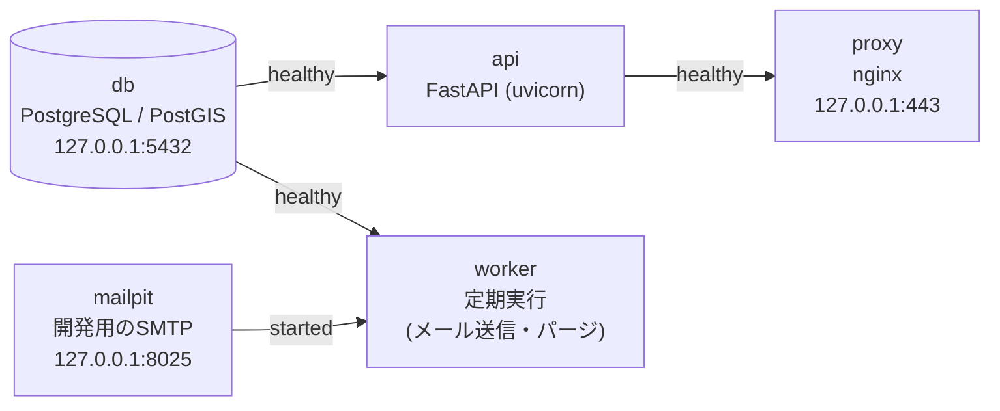
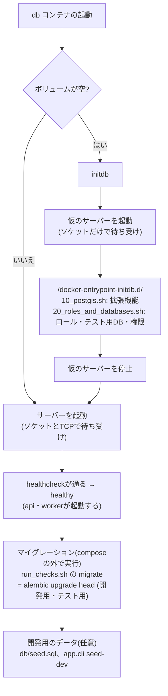

# バックエンド概要

backend(FastAPIのapi + 定期実行のworker + PostgreSQL)の構成・方針・実装方針・API(共通)・設定・起動・テスト。
2026-11-10時点のmainの実装を正とする。機能ごとの設計は同じディレクトリの各文書(`database.md`・`sync-api.md`・`auth.md`・`mail.md`・
`logging.md`・`https-proxy.md`)にある。

## 構成

### 選定の理由

APIサーバーはPython(FastAPI)、DBはPostgreSQL + PostGISにしている。

- リクエストの型検証とOpenAPIの仕様書が自動で生成されるので、APIとして何を決める必要があるかが見えやすい
- 認証・メール送信・定期実行を1つのコードベースにまとめられる
- 認証・認可をアプリの層で書けるので、DBを直接公開する構成(PostgREST等)より見通しがよい。外部の認証サービス(Supabase・Firebase Auth等)は、
  仕組みを理解するために使わない

### サービス構成(docker compose)

| サービス | 役割 |
|---|---|
| `proxy` | nginx。TLSを終端してHTTPSで公開し、`/api/`だけを`api`へ転送する(`backend/docs/https-proxy.md`) |
| `db` | PostgreSQL 16 + PostGIS 3.4 |
| `api` | uvicornでFastAPIを常駐させ、エンドポイントを提供する(`restart: unless-stopped`) |
| `worker` | `api`と同じイメージ・同じコードで、起動コマンドだけ変える。メール送信(outbox)とパージを定期実行する。ジョブが重複しないよう1つだけ起動する |
| `mailpit` | 開発用のSMTP受信サーバーとWeb UI。外部にメールを出さない |

- 定期実行を`api`と同じプロセスで動かさないのは、apiのワーカー数を増やしたときにジョブが重複して走るため
- DBへはcomposeのネットワークの中でサービス名`db`で接続する
- ホストに公開するのはproxyの443番(HTTPS)と、開発で使うdb・mailpitのポートだけで、いずれも`127.0.0.1`に限る。`api`はホストに公開しない
- 依存パッケージはイメージのビルド時に入れる。サーバーの起動・テストはホストの`docker compose`で行う
- スキーマはAlembicのマイグレーションで管理する(`backend/docs/database.md`)

### パッケージ

| 役割 | パッケージ |
|---|---|
| Webフレームワーク(ルーティング、依存注入) | FastAPI |
| サーバー本体(常駐プロセス) | uvicorn |
| リクエスト/レスポンスの型と検証 | Pydantic、email-validator(メールアドレスの形式) |
| 設定の読み込み | pydantic-settings |
| DBドライバ | psycopg(v3) |
| ORMとクエリ | SQLAlchemy 2.x |
| PostGISの型 | GeoAlchemy2 |
| スキーマのマイグレーション | Alembic |
| パスワードのハッシュ | pwdlib[argon2](passlibは保守が止まっているので使わない) |
| JWTの発行・検証 | PyJWT |
| メール送信 | 標準ライブラリのsmtplib |
| 定期実行 | APScheduler(`worker`の中) |
| テスト | pytest + pytest-asyncio、httpxの`AsyncClient`(`ASGITransport`) |
| パッケージ管理・lock | uv(`pyproject.toml` + `uv.lock`) |
| lint | ruff |

## 方針

- 認証基盤は外部サービスを使わず自前で実装する。パスワードの検証はサーバーだけで行い、端末にはパスワードを保存しない
  (トークンだけを`flutter_secure_storage`に保存する)。詳細は`backend/docs/auth.md`
- 同期はログイン中のユーザーのレコードだけを扱う。user_idはクライアントの申告(本文)ではなく、パスで指定してトークンと照合する
- トークンが切れていても端末での記録・閲覧はでき、止まるのは同期だけにする(オフラインファースト)
- メールアドレスの確認は、リンクではなく6桁のコードの入力にする(Universal Links・App Linksの設定を避けるため)。
  ログイン中のパスワードの変更は現在のパスワードで確かめる(メールは要らない)
- SNS的な機能(自己紹介・フォロー)は持たない。ユーザーの情報は表示名だけ
- APIはREST形式(`/users/{user_id}/sessions/...`)。URLにバージョン(`/v1`)は入れない(開発中の端末しか使わないため。
  公開して運用するなら、アプリのバージョンを見て更新を促す仕組みと合わせて決める)
- 同期の管理に使う時刻(`updated_at`・`deleted_at`・差分取得の基準時刻)はサーバー時刻を正とする。`started_at`・`ended_at`・`recorded_at`は
  端末で記録した時刻(データそのもの)なので、端末の時刻のまま
- 端末のログは回収しない(端末のコンソールに出すだけ。外部のサービスを使うかは、プライバシーポリシーと合わせて決める)

## 実装方針

- 非同期(`async def`)で書く。DBアクセスはSQLAlchemy 2.xの非同期API + psycopg(v3)
  - 関連の遅延ロードは使えないので、`selectinload`等で明示的に読み込む
  - テストは`httpx.AsyncClient` + `pytest-asyncio`、Alembicは非同期用の`env.py`、workerはAPSchedulerの`AsyncIOScheduler`
- DBアクセスはORM中心で、PostGISの部分はGeoAlchemy2で書く。ストアドファンクションは使わない
- レイヤ構成:

  | レイヤ | 役割 | Springで言うと |
  |---|---|---|
  | `routers` | URLとメソッドの対応、リクエストの受け取り、ステータスコード。認証は依存注入で付ける | `@RestController` |
  | `schemas` | リクエスト/レスポンスの型と入力チェック(Pydantic) | DTO + Bean Validation |
  | `services` | 業務ルール(競合の判定、所有者の確認など)とトランザクションの範囲 | `@Service` |
  | `models` | テーブルの定義(ORM) | `@Entity` |

- エラーレスポンスは`{"code": ..., "message": ..., "details": [...]}`に揃える(下記「API(共通)」の「エラーレスポンス」)
  - services層などで処理を続けられない場合は`AppError(ステータス, ErrorCode.xxx, メッセージ)`を投げる(`app/errors.py`)。
    例外ハンドラー(`app/error_handlers.py`の`install_error_handling`)がJSONのレスポンスに変える
  - bodyを受け取るエンドポイント(新規登録・ログイン・トークンの更新・表示名の変更・パスワードの変更・確認コードの確認、同期の登録・修正・
    restore・existence-check)には`dependencies=[Depends(require_json_content_type)]`を付け、Content-Typeが`application/json`でなければ415にする
    (`app/dependencies.py`)。bodyの無いPOST(ログアウト・確認コードの送信)とDELETEには付けない
  - bodyの大きさの上限(10MB)は、ミドルウェアで全てのリクエストにかける

## API(共通)

APIの入出力の型・各項目の説明・例・ステータスごとの`code`は、実装から自動で生成するOpenAPIにある。この節と各機能の文書の
「エンドポイント」には、OpenAPIに載らない判定の順番・処理の手順・判断の理由を書く。

- URL: `https://localhost/api`(開発環境。リバースプロキシ経由。`backend/docs/https-proxy.md`)。以下のパスは`/api`からの相対。
  実装は、同期が`app/routers/sessions.py`、認証・ユーザーが`app/routers/auth.py`・`app/routers/users.py`
- OpenAPIはリバースプロキシでは公開しない。apiのコンテナの中から取り出す:
  `docker compose exec api python -c "import urllib.request; print(urllib.request.urlopen('http://localhost:8080/openapi.json').read().decode())"`。
  内容(operationId・エラーのcodeの記載・例)は`tests/test_openapi.py`で確かめている

### 判定の順番

各エンドポイントの処理は、次の順に判定する(DBに問い合わせない確認を先に行う):

1. リクエストの形式: bodyの大きさ(413)、Content-Type(415)、Accept(406。GETの差分取得だけ)
2. 認証と権限: 401(`unauthenticated`・`token_expired`)、403(`forbidden`)、同期APIでは403(`email_not_verified`)
3. ユーザーの存在: 404(`user_not_found`)
4. 入力チェック: 422
5. 業務ルール(sessionの存在・削除済みかどうか等): 404(`session_not_found`)・409

ただし、パスパラメーターの書式の不正(UUIDでない等)は、ユーザーの存在の確認より先に422になる。

### 認証と権限

トークンの仕組みは`backend/docs/auth.md`。

- ログイン・新規登録・トークンの更新以外のエンドポイントは、`Authorization: Bearer <アクセストークン>`ヘッダーが必須
- リクエストのたびに、トークンの署名・有効期限に加えて、DBで「ユーザーが存在し停止(`disabled_at`)されていない」
  「`sid`の端末のログイン状態が無効になっていない」ことを確かめる(ログアウト・削除・停止がすぐ反映されるように)。
  ロールはトークンに入れず、リクエストのたびにDBから読む
- 401: 認証できない場合は`unauthenticated`(クライアントは再ログインを促す)、有効期限切れは`token_expired`
  (クライアントはリフレッシュトークンでトークンを更新し、元のリクエストをやり直す)
- 403(`forbidden`): 認証はできたが、管理者でなく、パスパラメーターのuser_idが自分自身でない。再ログインしても結果は変わらない
- 403(`email_not_verified`): 同期API(`/users/{user_id}/sessions/...`)は、メールアドレスの確認が済んでいなければ使えない
  (ログインはできる)
- この順に判定するので、一般ユーザーに404(`user_not_found`)が返ることはない(他ユーザーのuser_idは403で、自分自身が存在しなければ
  401で止まる)。404(`user_not_found`)は管理者が存在しないuser_idを指定した場合だけで、一般ユーザーには他ユーザーの有無が分からない
- パスパラメーターのuser_idは操作対象のユーザーを指定するためのもので、秘密の情報ではない(URLやログに残り、JWTの中身も
  暗号化されていない)。本人であることの確認はトークンの署名の検証だけで行う

### リクエストID

- 全てのレスポンスに`X-Request-ID`ヘッダーを付ける(アクセスログ・アプリのログ・監査ログの突き合わせに使う)。
  IDはリバースプロキシが作り、クライアントが送ったものは使わない(`backend/docs/https-proxy.md`の「リクエストID」)
- ログでの振り返りにだけ使い、処理(認証・重複の判定等)には使わない

### エラーレスポンス

- 4xx・5xxのbodyは全て`{"code", "message", "details"}`の形式で返す(形式と各`code`の意味はOpenAPI)。FastAPIが既定で返すエラー
  (バリデーションの422、存在しないパスの404など)も、例外ハンドラーでこの形式に揃える
- クライアントが処理を分岐する必要があるエラーには必ず`code`を付け、`code`の無いエラーは返さない(クライアントが
  「`session_not_found`以外の404では同期を止める」のように判定しやすくするため)。`message`は人が読むためのもので、分岐に使わない
- `details`は422のときだけ含める。`field`は受け取った場所(body/query/path/header)と項目名をドットでつなぐ(例: `body.move_method`)
- 想定外のエラー(500)では、原因(スタックトレース等)はサーバーのログにだけ出し、レスポンスには含めない
- OpenAPIのエンドポイントごとのレスポンスに載らない`code`:
  - `not_found`(404。存在しないパス)、`method_not_allowed`(405。`Allow`ヘッダーで使えるメソッドを返す)
  - リバースプロキシが返すもの: `service_unavailable`(502・504。apiにつながらない・応答が時間内に来ない。クライアントは後で再試行する)、
    送信元のIPごとの流量の上限の`too_many_requests`(429)、`http_error`(400。壊れたリクエスト)、`payload_too_large`(413)。
    詳細は`backend/docs/https-proxy.md`の「proxyが自分で返すエラー」
- `Retry-After`(429)・`X-Request-ID`のヘッダーは、OpenAPIではヘッダーとして定義せず、説明の文章にだけ書いている
- 実装: `app/errors.py`(`ErrorCode`・`AppError`)、`app/error_handlers.py`(例外ハンドラー・bodyの大きさの上限)、
  `app/dependencies.py`(Content-Typeの確認)、`app/schemas/error.py`(OpenAPIに載せるcodeの説明)

## 設定と秘密情報

- 設定は`app/config.py`の`Settings`(pydantic-settings)が環境変数から読む。`backend/.env`(コミットしない)はcomposeの変数展開
  (`${POSTGRES_PASSWORD}`等)に使い、composeが各サービスの`environment:`で必要な項目だけを渡す。`.env`はイメージに入れず
  (`.dockerignore`)、マウントもしないので、**composeが渡していない設定は`.env`に書いても効かず、`Settings`の既定値になる**
- `backend/.env`に書く項目:

  ```
  # 管理用のスーパーユーザー(拡張機能とロールの作成にだけ使う)
  POSTGRES_USER=postgres
  POSTGRES_PASSWORD=<任意の文字列>
  # 開発用・テスト用のデータベース
  POSTGRES_DB=location_db
  POSTGRES_TEST_DB=location_db_test
  # マイグレーション用のロール
  MIGRATOR_DB_USER=osampo_migrator
  MIGRATOR_DB_PASSWORD=<任意の文字列>
  # api用のロール
  APP_DB_USER=osampo_app
  APP_DB_PASSWORD=<任意の文字列>
  # worker用のロール
  WORKER_DB_USER=osampo_worker
  WORKER_DB_PASSWORD=<任意の文字列>
  ```

- 省略できる(既定値がある)設定のうち、composeが渡しているもの:

  | サービス | 設定(既定値) |
  |---|---|
  | api・worker | `LOG_FORMAT`(text)・`LOG_LEVEL`(INFO)。`backend/docs/logging.md` |
  | api・worker | `PURGE_RETENTION_DAYS`(90)。workerはさらに`PURGE_INTERVAL_HOURS`(24)。`backend/docs/sync-api.md`の「パージ(worker)」 |
  | api | `EMAIL_CODE_TTL_MINUTES`(10)・`EMAIL_CODE_MAX_FAILED_ATTEMPTS`(5)・`EMAIL_CODE_RESEND_INTERVAL_SECONDS`(60)・`EMAIL_CODE_DAILY_LIMIT`(5)。`backend/docs/mail.md` |
  | worker | `SMTP_HOST`(mailpit)・`SMTP_PORT`(1025)・`SMTP_USERNAME`・`SMTP_PASSWORD`・`SMTP_STARTTLS`(false)・`MAIL_FROM`・`MAIL_POLL_INTERVAL_SECONDS`(5)・`MAIL_MAX_ATTEMPTS`(5)・`OUTBOX_RETENTION_DAYS`(90)。`backend/docs/mail.md` |

- composeが渡していないので既定値で動いている設定: bodyの大きさの上限(10MB)、JWTの鍵のパス、アクセストークン(15分)・
  リフレッシュトークン(30日)の期限、ログインの試行回数の制限(15分以内に10回で15分)、SMTPのタイムアウト(10秒)、監査ログの保持期間(90日)
- ロール・パスワード・データベースは、DBのボリュームを初めて作ったときにだけ反映される。変えた場合は`docker compose down -v`で
  ボリュームを作り直す(作り直した後はマイグレーションとシードの投入が要る。`docs/commands.md`の「DBの作り直し・シード」)
- JWTの署名鍵とTLSの証明書は`backend/secrets/`に置く(コミットしない。作り方は`docs/development.md`の「初回の準備」)

## 起動とヘルスチェック

- `api`の`/health`(`SELECT 1`でDBに接続できるかを確かめ、できなければ503)を、composeの`healthcheck`で使う。
  `/health`は運用のためのものなので、APIのパス(`/api/...`)の外に置く
- 起動の順番は`depends_on`で決める:
  - `api`・`worker`は`db`の`healthcheck`が通ってから起動する(`condition: service_healthy`)
  - `worker`は`mailpit`が起動してから起動する(`condition: service_started`)
  - `proxy`は`api`の`healthcheck`が通ってから起動する(起動直後の502を避ける。`backend/docs/https-proxy.md`)
  - `db`の`healthcheck`の`pg_isready`はTCP(`-h localhost`)で確かめる。ソケットで確かめると、ボリュームを作った直後の初回の起動で、
    初期化中の仮のサーバー(`docker-entrypoint-initdb.d`のスクリプトを実行する間、ソケットだけで待ち受ける)にも準備完了と答え、
    `api`・`worker`が接続できずにエラーになる。CIのサービスコンテナも同じ理由でTCPにしている
- 起動の順番(矢印の元のサービスが、矢印のラベルの状態になってから起動する):



- DBのボリュームが空のとき(初回、`docker compose down -v`の後)だけ、dbは初期化してから起動する。
  **テーブルはcomposeの起動では作られない**。マイグレーションは起動とは別に実行する(`backend/docs/database.md`の「スキーマとマイグレーション」)。
  workerはマイグレーションの前だとテーブルが無いエラーを出すが、マイグレーションの後の次の実行で回復する



- 開発中の`api`はソースコード(`app/`・`tests/`・`migrations/`)をbind mountし、uvicornの`--reload`で変更を反映する。
  依存パッケージの仮想環境はイメージの中の`/opt/venv`に作るので、bind mountで隠れない
- 依存パッケージは`pyproject.toml`に書き、`uv.lock`で固定する(イメージのビルドは`uv sync --locked`)。
  `uv.lock`の生成・更新は`backend/scripts/run_checks.sh`の`lock`(uvのDockerイメージで`uv lock`を実行する)で行う

### 開発環境での注意

- **メインのチェックアウトとworktreeの`backend`は、composeのプロジェクト名が同じ`backend`になる**(`docker-compose.yml`に
  `name:`が無く、ディレクトリ名から決まるため)。そのため次のようになる:
  - コンテナとDBのボリューム(`backend_postgis_data`)を共有する。mainで`seed-dev`したユーザーはworktreeでもそのまま使え、
    ユーザーの登録し直しは要らない
  - どちらで`up`したかで、apiにbind mountされる`app/`・`secrets/`の場所が変わる。同時に起動しない
  - 古いコンテナが残っていると、`secrets/`(JWTの鍵)のマウントが反映されず、ログインだけが500(`/app/secrets/jwt_private.pem`の
    FileNotFoundError)になることがある。`docker compose down`してから`up`し直す
- **秘密鍵はログインでトークンを発行するときに初めて読む**。トークン無しのリクエストへの401は鍵を読む前に返るので、
  401が返っても鍵があることの証拠にならない。鍵がコンテナから見えるかは`docker compose exec api ls -la /app/secrets`で確かめる
- 挙動がおかしいときは、`docker compose down`してから`up`し直す(`down -v`はDBのボリュームも消すので、データを残すなら付けない)
- composeのネットワークはサブネットを固定している(proxyのIPを固定するため)。ネットワークの設定を変えた後や、
  古い構成のコンテナ・ネットワークが残っている場合は、`docker compose down`してから`up`する(DBのボリュームは消えない)

## テスト

- pytestで書き、ホストで`backend/scripts/run_checks.sh`経由で実行する(中では`docker compose run --rm -T api pytest`)。
  CIではランナーの上で直接実行する(`docs/development.md`の「CI・Dependabot」)
- テスト用のDBは、同じPostgreSQLのコンテナの中に別のデータベース(`POSTGRES_TEST_DB`)として作る(コンテナを増やさず、開発用のデータとも
  分けるため)。スキーマはAlembicで作る
- テストごとにトランザクションを開始し、終わったらロールバックして後片付けする(TRUNCATEより速いため)。
  非同期のSQLAlchemyでは、FastAPIの`dependency_overrides`でDBセッションをテスト用のものに差し替える
- lintはruffの既定のルールに、DTZ(タイムゾーンなしの日時の指摘)を加えたもの(`pyproject.toml`の`[tool.ruff.lint]`)。
  フォーマッタ(`ruff format`)は使っていない
