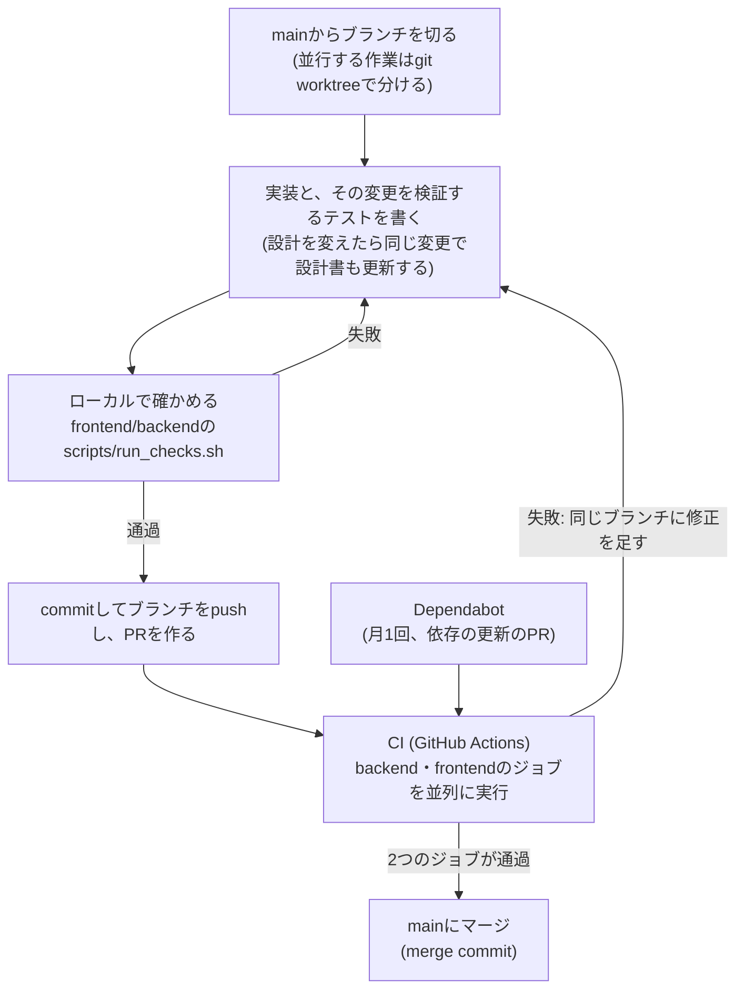
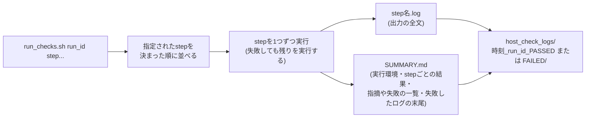
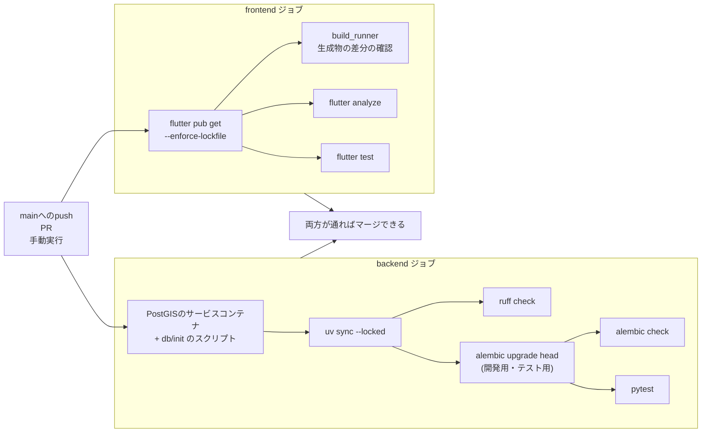
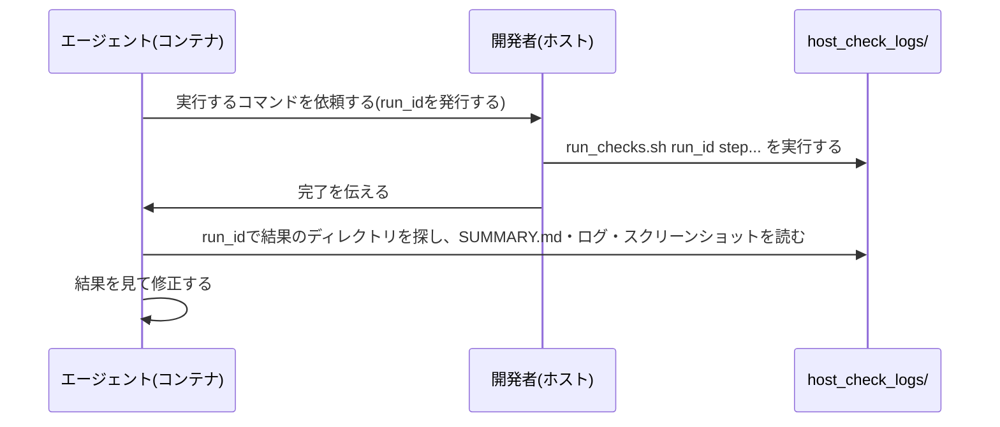

# 開発ガイド

このリポジトリで開発するためのガイド。1〜2で初回の準備から起動までをこの文書だけで行える。3〜4はリポジトリの構成と
ドキュメントの案内、5はこのプロジェクトで採っている開発・運用の取り決め。
コマンドは場面ごとに`docs/commands.md`にもまとめている。システムの全体像は`docs/basic-design/system-overview.md`を参照。

## 1. 開発環境

開発者のPC(macOSを想定)に次のものを入れる。backendの依存パッケージ(Python・uv)はDockerのイメージの中にあるので、PCには要らない。

- Flutter SDK(CIと同じバージョン。`.github/workflows/ci.yml`の`flutter-version`)と、iOSシミュレータのためのXcode
- Docker(`docker compose`)。backendの起動・マイグレーション・テストはすべてcompose経由で行う
- mkcert・openssl・curl(HTTPSの証明書と、署名鍵の作成・確認)

### 初回の準備

以下は`backend`ディレクトリで実行する。作ったファイル(`backend/.env`・`backend/secrets/`)はコミットしない。

1. `backend/.env`を作る。項目は`backend/docs/バックエンド構成.md`の「設定と秘密情報」
2. アクセストークンを署名するES256の鍵のペアを作る

   ```bash
   mkdir -p secrets
   openssl ecparam -name prime256v1 -genkey -noout -out secrets/jwt_private.pem
   openssl ec -in secrets/jwt_private.pem -pubout -out secrets/jwt_public.pem
   ```

3. HTTPSの証明書をmkcertで作る(約2年で期限が切れるので、その前に作り直す。`mkcert -install`は実行しない。
   理由は`backend/docs/HTTPSとリバースプロキシ.md`の「証明書」)

   ```bash
   mkdir -p secrets/tls
   mkcert -cert-file secrets/tls/cert.pem -key-file secrets/tls/key.pem localhost 127.0.0.1 10.0.2.2
   ```

4. iOSシミュレータにmkcertのCAを入れる(シミュレータを起動した状態で。シミュレータを作り直したり初期化したりしたら入れ直す)

   ```bash
   xcrun simctl keychain booted add-root-cert "$(mkcert -CAROOT)/rootCA.pem"
   ```

## 2. 起動方法

### backend

`backend`ディレクトリで実行する。`<run_id>`は実行を識別する任意の文字列(5の「テスト」)。

```bash
# 起動(イメージのビルド)とマイグレーション。テーブルはcomposeの起動では作られず、マイグレーションで作る
scripts/run_checks.sh <run_id> up migrate
# 開発用のダミーデータ(DBを作り直したとき。テーブルの所有者のロールで入れる)
docker compose exec -T db psql -U osampo_migrator -d location_db < db/seed.sql
# 開発用のユーザー(管理者・テストユーザー・メール未確認のユーザー)のパスワード等を設定する。ログイン情報が表示される
docker compose run --rm api python -m app.cli seed-dev
# 動作の確認
curl --cacert "$(mkcert -CAROOT)/rootCA.pem" https://localhost/api/
```

- APIは`https://localhost/api`(リバースプロキシ経由)。送信したメールはMailpitの http://localhost:8025 で見る
- サービスの構成・起動の順番・DBの初回の初期化の流れは`backend/docs/バックエンド構成.md`の「起動とヘルスチェック」
- 2回目以降で依存パッケージ・Dockerfile・composeを変えていなければ、`docker compose up -d`だけでよい

### frontend

`frontend`ディレクトリで実行する。

```bash
flutter pub get
flutter run
```

- iOSシミュレータで動かす。接続先のAPIは既定で`https://localhost/api`。Androidエミュレータ・実機は証明書を信頼させる対応を
  していないので、今は使えない
- 初回起動時は、自動で作られたローカルアカウント(同期しない)で入った状態から始まる。同期を試すときは、`seed-dev`で表示された
  ユーザーでログインする

## 3. ディレクトリ構成

- .github: GitHub Actionsのワークフロー(`workflows/ci.yml`)とDependabotの設定(`dependabot.yml`)。5の「CI・Dependabot」
- backend: Dockerで動かすバックエンド(FastAPIのapi + 定期実行のworker + PostgreSQL)
  - app/: FastAPIのアプリ本体(config.py: 設定、db.py: DB接続、main.py: アプリ、worker.py: 定期実行、
    logging_config.py・request_context.py: ログの形式とリクエストID・アクセスログ、security.py: パスワードのハッシュ・トークン、
    mail.py: SMTPでのメールの送信、cli.py: 管理用のコマンド(シード・アカウントの停止・テストメール)、
    routers/・schemas/・services/・models/: レイヤ。詳細は`backend/docs/バックエンド構成.md`)
  - tests/: pytest
  - pyproject.toml・uv.lock: 依存パッケージ(uv)。Dockerfile: api・worker共通のイメージ
  - alembic.ini・migrations/: Alembicのマイグレーション。0001は旧initdb.sqlのスキーマ(とPostgREST用のストアドファンクション)を
    そのまま写したもの、0002は高度関連の3列のdouble precision化、0003はPostgRESTの削除(ストアドファンクションの削除と
    deleted_atの「削除した日時」への統一)、0004は認証、0005はメールのoutbox、0006はメールアドレスの確認コード、0007は監査ログ、
    0008は監査ログのリクエストID、0009はRLSとworker用のロールの権限
  - db/init/: DBコンテナの初回起動時に実行するスクリプト(ロール(migrator・api・worker)・テスト用データベース・拡張機能・権限)
  - db/seed.sql: 開発用のダミーデータ(テストユーザー`1111...`とセッション)
  - proxy/: リバースプロキシ(nginx)の設定。TLSを終端してHTTPSで公開し、`/api/`だけをapiへ転送する
  - docker-compose.yml: proxy / db / api / worker / mailpit。DBの接続情報は`backend/.env`(コミットしない)。
    メールはapiがoutboxに積み、workerがmailpitへ送る
  - scripts/: run_checks.sh(マイグレーション・lint・テスト等をcompose経由で実行し、結果を`host_check_logs/`へ保存)
  - docs/: API設計・バックエンド構成の詳細設計(4の「ドキュメント索引」)
- docs: 基本設計・詳細設計・テスト・コマンド集(4の「ドキュメント索引」)
- frontend: Flutterによるモバイルアプリ本体(`flutter create`の出力から開発)
  - docs/: フロントエンド概要(実装上の注意)、ユーザー機能追加に伴うfrontendの変更内容(4の「ドキュメント索引」)
  - lib/
    - auth/: 認証(ログイン・トークンの更新・ログアウト・アカウントの削除)、トークンのsecure storageへの保存、
      アクセストークンを付けるHTTPクライアント(authorized_client.dart)
    - database/: Drift定義(ローカルSQLite)。ログインしたユーザー(users)ごとにデータを分ける
    - repositories/: リモート同期ロジック(push/pull/競合解決)
    - services/: tracking_service.dart(位置情報監視・収録の状態管理の中心)、
      location_stream_settings.dart(位置情報ストリームのプラットフォーム別設定)
    - models/: RecordingSession/Status/MoveMethod、RecordingPhase(収録の状態遷移)、
      LocationBannerState/LocationBannerKind(位置情報バナーの状態)
    - providers/: Riverpodのprovider定義
    - views/: 画面(main_page / recording_page / saved_sessions / session_detail_view /
      save_or_discard_page / gps_help_page / settings_page、auth/のログイン・新規登録 など)。
      起動時の画面は`main.dart`のAuthGate(未ログインならログイン画面)
    - widgets/: 全タブ共通のバナー(location_banner_view / recording_phase_banner_view /
      auth_banner_view)、地図に重ねるOpenStreetMapのクレジット(osm_attribution)など
    - utils/: navigatorKeyやダイアログ等、UI外から呼ぶための小物。save_or_discard_screen.dartは
      保存/破棄画面を開く共通の入口`showSaveOrDiscardScreen()`。map_tiles.dartは地図タイルのURLとUser-Agentの設定
  - android/, ios/: 各OSの端末設定
  - test/: ユニット/ウィジェットテスト
  - integration_test/: `flutter drive`によるE2Eシナリオ(スクリーンショット取得含む)
  - test_driver/: `flutter drive`のドライバ(スクリーンショットをファイルとして保存する)
  - scripts/: run_checks.sh(解析・テスト等を実行し結果を`host_check_logs/`へ保存)と、
    そのe2eステップだけを呼ぶrun_e2e_tests.sh

## 4. ドキュメント索引

各ドキュメントの内容と、どの作業に関係するか。設計を変えたら同じ変更で該当ドキュメントも更新する。
実装上の注意(落とし穴)は、関係する各ドキュメントに書いている。

| ドキュメント | 内容 | 関係する作業 |
| --- | --- | --- |
| `docs/commands.md` | 場面ごとのコマンド集(準備・起動・DBの作り直し・チェック・ログ・管理用のコマンド) | コマンドを探す |
| `docs/basic-design/` | 基本設計書(システム概要・機能一覧・画面一覧と遷移・データ設計・API一覧・認証とセキュリティ)。全体像と一覧に徹し、詳細は下記の各文書へリンクする | 全体像を掴む、機能・画面・テーブル・APIを追加/削除する(該当の一覧も更新する) |
| `docs/design/sync.md` | pull型差分同期、tombstone削除、削除と編集の競合 | `repositories/`・`backend/`を触る |
| `frontend/docs/location-tracking.md` | RecordingPhase、timeLimit、位置情報バナー、収録開始のフォールバック、権限喪失時の強制停止 | `tracking_service.dart`・バナー・`main_page`/`recording_page`を触る |
| `frontend/docs/background-recording.md` | バックグラウンドでの収録継続と非収録時の購読停止 | 位置情報の購読設定・ライフサイクル・権限・マニフェストを触る |
| `frontend/docs/session-recovery.md` | 起動時の未完了セッション回収、保存/破棄画面 | 収録停止〜保存/破棄の流れを触る |
| `frontend/docs/screens.md` | 各画面・バナー・utilsの個別仕様(編集ダイアログの挙動等) | `views/`・`widgets/`・`utils/`を触る |
| `frontend/docs/e2e.md` | integration_testの書き方・スクリーンショット・実DBの後始末 | `integration_test/`を書く・直す |
| `backend/docs/API設計ドラフト.md` | APIサーバー(FastAPI)のエンドポイント・エラー形式・認証と権限 | APIを実装する、APIの仕様を変える |
| `backend/docs/バックエンド構成.md` | 構成の選定理由・主な決定事項と、実装方針・起動の仕組み・マイグレーション・DBロール・パージ・テストの詳細設計 | `backend/`を触る |
| `backend/docs/HTTPSとリバースプロキシ.md` | リバースプロキシ(nginx)・証明書(mkcert)・TLSの設定・送信元のIPとリクエストID・流量などの上限 | `backend/proxy/`・composeのポート・証明書・接続先のURLを触る、アプリがAPIにつながらない |
| `backend/docs/メール送信の運用.md` | メールをサーバーから送って運用するための論点(送信手段・到達性・バウンス・outbox・悪用対策・テスト)の整理 | メール送信の設計・実装をする |
| `frontend/docs/フロントエンド概要.md` | frontendの概要。今はfrontendの実装上の注意(同期・位置情報・地図・レイアウト・Drift・依存パッケージ)の症状・原因・見分け方 | `frontend/`を触る、似た不具合を調べる |
| `frontend/docs/ユーザー機能追加に伴う変更予定.md` | APIに合わせてfrontendで必要になる変更 | `repositories/`・認証・アカウントまわりを触る |

## 5. 開発・運用ルール

ここから先は、このプロジェクトで今採っている開発・運用の取り決め(開発の流れ・コーディング規約・テスト・CI・git・
AIコーディングエージェントの使い方)。起動して動かすだけなら1〜2で足りる。

### 開発の流れ



- **テストを軸に進める**。実装と一緒に、その変更を検証するテスト(`test/`配下のユニット/ウィジェットテスト、画面の確認が必要なら
  `integration_test/`のシナリオ、backendはpytest)を書く
- ローカルの確認は`scripts/run_checks.sh`で行い、結果はファイル(`host_check_logs/`)に残る(下記「テスト」)。
  E2E・画面の確認と、コミットするファイルを作る処理(コード生成の`codegen`、依存の固定の`lock`)はローカルでしかできない。
  それ以外のチェックはCIでも実行するので、ローカルではpushの前に確かめたいときに使う
- push・PRごとに、E2E以外のチェック(backendのlint・マイグレーション・pytest、frontendのコード生成物の確認・analyze・test)を
  CIで実行し、通ったものだけをmainにマージする(下記「CI・Dependabot」「git」)

### コーディング規約

- 現状はlinterは未導入(frontend)。backendはruffの既定のルールに、DTZ(タイムゾーンなしの日時の指摘)を加えたもの(`pyproject.toml`の`[tool.ruff.lint]`)
- Dartのインデントは2文字、SQLのインデントは4文字で行い、Dartではリスト項目の末尾にも`,`を入れる
- 端末のログは`utils/app_log.dart`の`appLog`で出す(`print`は使わない)

### テスト

- 標準の`flutter_test`(`test/`配下)以外のテストフレームワーク・モックライブラリは未導入
- **ローカルでのチェックは`frontend/scripts/run_checks.sh`・`backend/scripts/run_checks.sh`で行う**。どちらも同じ形で動く:



| | stepの実行順 | 省略時 | `all` |
| --- | --- | --- | --- |
| frontend | `pubget` → `codegen` → `analyze` → `test` → `e2e` | `analyze test` | `analyze test e2e` |
| backend | `lock` → `up` → `migrate` → `check` → `lint` → `test` → `https` | `migrate check lint test` | `up migrate check lint test https` |

- `run_id`は**実行を識別する任意の文字列**で、結果のディレクトリ名に入る。テスト内容の説明ではなく、実行ごとに変わる文字列にする
  (同じテストの再実行でも変える)と、どの実行の結果かを取り違えない
- 結果はまず`SUMMARY.md`を読む。`host_check_logs/`は`.gitignore`済み。前回の実行の結果も残るので、比べるのにも使える
- 実行の例は`docs/commands.md`の「チェック」
- frontend(`frontend`ディレクトリで実行):
  - stepは`pubget`(flutter pub get)/`codegen`(build_runner)/`analyze`/`test`/`e2e`/`all`。`test`は`-t <path>`(複数可)で対象を絞れる
    (省略すると`test/`配下を全件実行する)。`analyze`は`--no-fatal-infos`で実行するためinfoだけではFAILEDにならないが、指摘は全件記録する
  - 結果は`frontend/host_check_logs/`。`SUMMARY.md`には実行環境(ブランチ/コミット/未コミット変更の有無/Flutterのバージョン)、
    analyzeの指摘一覧、testの失敗テスト名が入る。e2eのスクリーンショットは`screenshots/`にコピーされる
  - Driftの`*.g.dart`などコード生成物は`codegen`で更新してコミットする
- E2E/画面確認は`integration_test` + `flutter drive`で行う。E2Eだけなら
  `scripts/run_e2e_tests.sh <run_id>`でもよい(`run_checks.sh <run_id> e2e`のラッパー)。
  デバイスの決定順は`-d <device_id>` > `E2E_DEVICE_ID`環境変数 > `run_checks.sh`冒頭の
  `DEFAULT_DEVICE_ID`。シナリオは`-e <path>`で変えられる(省略時は`integration_test/app_test.dart`。
  機能紹介用のスクリーンショットは`integration_test/showcase_test.dart`)。シナリオの書き方は`frontend/docs/e2e.md`
- `integration_test`は実機/シミュレータの本物の`app.sqlite`に対して動く。**seedして保存した
  セッションは必ず`addTearDown`等で後始末すること**(実機の履歴・リモートDBが汚染される)
- backend(どこから実行してもよい):
  - stepは`lock`(uvのDockerイメージでuv lock)/`up`(docker compose up -d --build --wait)/`migrate`(開発用・テスト用DBへのalembic upgrade head)/
    `check`(alembic check)/`lint`(ruff check)/`test`(pytest。`-t`で絞れる)/`https`(リバースプロキシ越しのHTTPSの確認。curlで証明書・ヘッダー・上限を確かめる)/`all`
  - 依存パッケージを変えたら`lock up`、Dockerfile・compose・`pyproject.toml`・`alembic.ini`を変えたら`up`も付けて実行する
    (`app/`・`tests/`・`migrations/`以外はbind mountしていないので、イメージの作り直しが必要)
  - 結果は`backend/host_check_logs/`。`SUMMARY.md`には実行環境、適用したマイグレーションとrevision、alembic checkの結果、ruffの指摘、
    pytestの失敗一覧と詳細が入る
  - 前提: `backend/.env`があり、`up`以外のstepはサービスが起動済みであること

#### デバッグの手がかり

- 端末のログは`appLog`の`[sync] ...`・`[auth] ...`・`[http] ...`の行で見る(リリースビルドでは出さない)。
  通信は`[http]`の行に応答のリクエストID(`X-Request-ID`。リバースプロキシが作る)が出るので、backendのログ
  (`docker compose logs proxy api | grep <ID>`)と突き合わせられる。応答が届かなかったリクエストはIDが無いので、時刻でproxyのログを探す
- backendのログは`docker compose logs proxy`・`docker compose logs api`・`docker compose logs worker`で見る(key=value。`LOG_FORMAT=json`でJSON)。
  3つのログ(アクセス・アプリ・監査)の役割は`backend/docs/バックエンド構成.md`の「ログ」
- 複数端末での同期テストは、複数のシミュレータ/実機で同じユーザー(`app.cli seed-dev`のテストユーザー
  `testuser@example.com`等)にログインして行う。同期はメールアドレスが確認済みのユーザーでしか行われない
- アプリがAPIにつながらないときは`backend/docs/HTTPSとリバースプロキシ.md`の「つながらないとき」、backendの挙動がおかしいときは
  `backend/docs/バックエンド構成.md`の「開発環境での注意」

### CI・Dependabot

`.github/workflows/ci.yml`。mainへのpush・PR・手動実行(Actionsのタブ)で、`backend`と`frontend`の2つのジョブを並列に実行する。
mainへはPR経由でしか入れず、2つのジョブが通らないとマージできない(GitHubのルールセットで設定)。



- 矢印は前提を表す。前提のステップ(依存のインストール、backendのマイグレーション)が失敗したら、それを使うステップは実行しない。
  前提が成功していれば、ほかのチェックが失敗しても残りのチェックは実行する(`if: ${{ !cancelled() && ... }}`。1回の実行で全ての問題が分かるように)
- `backend`: composeと同じ`db/init/20_roles_and_databases.sh`をサービスコンテナの中で実行して、ロール・テスト用データベースを作る。
  Pythonはランナー上のuv(Python 3.12)で動かす。APIはpytestの中でアプリを直接呼び、workerはジョブの関数を直接呼ぶので、
  api・worker・mailpitのコンテナは起動しない(Dockerfileでのビルドと起動は確かめていない)
- `frontend`: Flutterのバージョンはローカルと同じ値に固定する(ローカルのFlutterを上げたら、`ci.yml`の`flutter-version`も同じPRで上げる)
- `uv sync --locked`・`pub get --enforce-lockfile`は、lockファイルが`pyproject.toml`・`pubspec.yaml`と食い違っていると失敗する。
  依存パッケージを変えたら、ローカルで`lock`(backend)・`pubget`(frontend)を実行してlockファイルもコミットする
- 生成物の確認で失敗したら、ローカルで`run_checks.sh <run_id> codegen`を実行して生成物をコミットする
- CIのDBの接続情報は使い捨てのダミーの値で、`ci.yml`に直接書いている(秘密情報ではない)
- アクションはタグではなくコミットのSHAで固定する(タグは付け替えられるため)。更新は`.github/dependabot.yml`の
  バージョン更新(月1回、アクション・uv・pubの種類ごとに1つのPR)で行い、CIが通ればマージする

### git

- 作業はブランチを切って行い、並行する作業はgit worktreeで分ける。worktreeごとに依存・生成物が別になるため、
  作った直後に`run_checks.sh <run_id> pubget`(テーブル定義を変えた場合は`codegen`も)を実行する。backendの`docker compose`は
  ディレクトリ名から同じプロジェクト名(`backend`)になるので、メインのチェックアウトとworktreeで同時に起動しない
  (`backend/docs/バックエンド構成.md`の「開発環境での注意」)
- commitメッセージはConventional Commitsに従う
- 1PR1目的を基本とし、無関係な変更を混在させない
- mainへの直接のpushは禁止。ブランチをpushしてPRを作り、CIが通ってからマージする。CIで見つかった問題は同じブランチに
  修正のコミットを足して直す
- マージはmerge commit(`gh pr merge --merge`)を基本とし、PRの中の個々のコミットを残す。squash・rebaseも設定上は許可している。
  PR単位の履歴は`git log --first-parent main`で見る
- `frontend/pubspec.lock`はコミット対象(Flutterはアプリについてはlockをコミットするのが公式推奨)。
  `flutter analyze`等の実行で無関係な依存バージョンの差分が紛れ込むことがあるので、
  意図しない変更はコミット前に`git checkout`で戻す

### AIコーディングエージェントを使った開発

このリポジトリの開発ではAIコーディングエージェント(Claude Code)も使っている。上記の流れ・ルールはエージェントを使う場合も同じで、
ここではエージェントを使うときの構成・運用・落とし穴をまとめる。

#### 構成

- エージェントは、PCのほかのファイルに触れたり外部へ自由に通信したりしないよう、権限と通信先を制限したコンテナ(devcontainer)の中で動かす。
  リポジトリはbind mountでPC(ホスト)と共有する
- コンテナにはFlutter SDKもDockerデーモンも入れない。解析・テスト・コード生成・ビルド・シミュレータの操作・`docker compose`は、
  開発者がホストで`run_checks.sh`等を実行して行う
- そのため、エージェントは実装と一緒にその変更を検証するテストを書き、E2E以外のチェックはCIで確かめる。CIの結果は
  `gh pr checks <番号>`・`gh run view <run_id> --log-failed`で読める

#### ホストでの実行と結果の受け渡し

`run_checks.sh`が結果をファイルに残すので、ホストでの実行結果を、出力を貼り付けずにエージェントへ渡せる。



- エージェントはコピペで実行できる完全な形のコマンドを示し、開発者は実行と完了の報告だけを行う
- `run_id`は依頼のたびに新しく発行する(再実行の依頼でも変える)。複数の作業が並行しても、どの依頼の結果かを取り違えない
- E2E: シナリオ(`integration_test/*.dart`)はエージェントが書き、実行は開発者がホストで行う。エージェントは結果の
  `host_check_logs/.../screenshots/`(実行直後なら`frontend/integration_test_screenshots/`も同じ内容)の画像を開いて確かめる
- コミットするファイルを作る処理(`codegen`・`lock`)もホストで実行してもらい、できたファイルをコミットする
- 結果を確かめるまで(CIかホストの実行結果を読むまで)は、動作を確認したことにしない

#### worktree

- エージェントの並行する作業は`.claude/worktrees/<作業名>/`(`.gitignore`済み)のgit worktreeで分ける
- コンテナで作ったworktreeをホストからも開いてテストできるよう、gitは2.48以上を使い、worktreeの参照を相対パスで記録する
  (`worktree.useRelativePaths=true`)。絶対パスだと、コンテナとホストでパスが違うため、ホストのgitがworktreeを認識できない
  (その場合も`run_checks.sh`は動き、`SUMMARY.md`にブランチ等の取得に失敗したことを残す)

#### 落とし穴: コンテナとホストでVSCodeを同時に開く

- **`frontend`はコンテナとホストの両方からbind mountで同じファイルが見えるため、
  コンテナ側でVSCodeを開いたままにしていると、そのDart拡張が`pubspec.lock`等の
  変更をファイルウォッチャーで検知して自動で`flutter pub get`を実行してしまうことがある**。
  ホストが書いた`.dart_tool/package_config.json`(正しいホストのパス`/Users/...`)が、
  コンテナ側のFlutterによってコンテナ内のパス(`/home/node/flutter/...`)で上書きされ、
  ホストでのXcodeビルド中にこの上書きへ当たると`flutter`本体を含む外部パッケージが軒並み解決できなくなる
  (Xcodeのビルドログには"Missing package product"や大量の`isn't defined`エラーとして現れ、`flutter clean`や
  DerivedData削除を繰り返しても再現し続けるため原因が非常に分かりにくい)
- リポジトリ直下・`frontend`直下いずれの`.vscode/settings.json`にも`"dart.runPubGetOnPubspecChanges": "never"`を
  設定済みなので、コンテナ側/ホスト側どちらのVSCodeでも有効になっているか確認すること。原因の切り分けでは、ホストで
  `grep -o '"rootUri": *"[^"]*flutter[^"]*"' .dart_tool/package_config.json`を実行し、
  `rootUri`がホストのパスかコンテナのパスかを見ると早い
- この不具合は、コンテナ内にFlutterがあった時期に発生した。現在はコンテナにFlutterを入れない方針なので同じ経路では再発しない
  はずだが、設定は念のため残しておく
